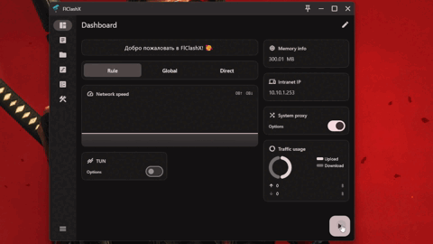

<div align="right">

**简体中文** · [English](README_EN.md)

</div>

# FlClashX

[](https://github.com/gscsdx/WFlClashX/releases/latest)
[](https://github.com/gscsdx/WFlClashX/releases)
[](https://github.com/gscsdx/WFlClashX/actions)
[](LICENSE)

基于 [Clash.Meta（mihomo）](https://github.com/MetaCubeX/mihomo) 内核的多平台代理客户端：**Flutter 写界面，Go 写内核**，开源、无广告。

本项目 Fork 自 [FlClash](https://github.com/chen08209/FlClash) → [FlClashX](https://github.com/pluralplay/FlClashX)，在此基础上完成了三件主要工作：

1. **新增鸿蒙（HarmonyOS NEXT）原生端** —— ArkTS `VpnExtensionAbility` + NAPI 桥接同一套 Go 内核，TUN 链路改为 gVisor 纯用户态实现；
2. **全平台云端构建** —— GitHub Actions 一条流水线产出 Android / Windows / Linux / macOS 安装包，发版自动化；
3. **界面整理** —— 新增渐变启动页，精简「关于」页面（仅保留项目地址）。

> 项目代号 **Wormhole**：`pubspec.yaml` 中包名为 `wormhole`，鸿蒙 BundleName 为 `com.wormhole.app`；桌面与 Android 的可执行文件、安装包沿用上游名称 `FlClashX`。

桌面端界面：

<p align="center">
  
</p>

移动端界面：

<p align="center">
  
</p>

---

## 平台支持

| 平台 | 架构 | 产物格式 | 状态 |
| --- | --- | --- | --- |
| **Android** | arm64-v8a / armeabi-v7a / x86_64 | APK（含 universal 包） | ✅ 云端构建 |
| **Windows** | amd64 / arm64 | ZIP + Inno Setup 安装器 | ✅ 云端构建 |
| **Linux** | amd64 / arm64 | deb / rpm / AppImage | ✅ 云端构建 |
| **macOS** | amd64 / arm64 | DMG | ✅ 云端构建 |
| **HarmonyOS NEXT** | arm64 | HAP | ✅ 本机构建（需 DevEco 签名） |

内核版本：mihomo `v1.19.28`；TUN 栈基于 `metacubex/sing-tun v0.4.21`（鸿蒙端使用仓库内置的 vendored 分支）。

---

## 下载

前往 [**Releases**](https://github.com/gscsdx/WFlClashX/releases/latest) 下载对应平台的安装包。以 `v0.4.2` 为例共 14 个产物：

| 平台 | 文件 |
| --- | --- |
| Android | `FlClashX-android-arm64-v8a.apk`、`-armeabi-v7a.apk`、`-x86_64.apk`、`-universal.apk` |
| Windows | `FlClashX-windows-amd64.zip` / `-setup.exe`、`FlClashX-windows-arm64.zip` / `-setup.exe` |
| Linux | `FlClashX-linux-amd64.AppImage` / `.deb` / `.rpm`、`FlClashX-linux-arm64.deb` |
| macOS | `FlClashX-macos-amd64.dmg`、`FlClashX-macos-arm64.dmg` |

### 签名说明（重要）

云端构建**不携带任何商业签名证书**，因此：

- **Android**：APK 使用 debug 签名，可直接安装测试，但**不能上架应用商店**；
- **Windows**：未做代码签名，SmartScreen 会提示「未知发布者」，选择「仍要运行」即可；
- **macOS**：dmg 未签名、未公证，首次打开请 **右键 →「打开」**，或执行 `xattr -cr /Applications/FlClashX.app`；
- **Linux**：deb / rpm 未签名；AppImage 需先 `chmod +x`。

如需正式分发，请自行配置签名证书（Android keystore、Apple Developer ID、Windows 代码签名证书）。

---

## 功能特性

### 代理内核

- 基于 mihomo 的规则引擎：规则 / 全局 / 直连三种模式，支持订阅、策略组、延迟测速、连接列表与实时流量统计；
- TUN 模式（Windows / Linux / macOS / Android / HarmonyOS）与系统代理模式（桌面端）；
- 分应用代理（Android / 鸿蒙）、进程匹配、DNS 与 GeoIP 分流。

### 订阅面板集成（面向 [Remnawave](https://github.com/remnawave/panel)）

- **HWID 上报**：向面板上报设备指纹；
- **公告组件**：把面板公告显示在首页；
- **Meta-Info 组件**：剩余流量、到期时间、订阅名称，临近到期（3 天内）高亮提示；
- **serviceInfo 组件**：显示服务名与自定义 Logo，点击打开支持链接；
- **changeServerButton**：一键跳转代理页；
- **组件顺序由订阅控制**：见下方 `flclashx-widgets`。

### 体验与界面

- 渐变启动页，全屏铺满、无白屏闪烁；
- 「关于」页精简为唯一一项「项目」，指向 [本仓库](https://github.com/gscsdx/WFlClashX)；
- Android 120Hz 高刷支持；Android TV 遥控器操作优化（粘贴按钮、策略组选择、手机扫码传配置）；
- macOS 原生状态栏常驻；
- 界面背景透明度可调；
- 多语言：简体中文 / English / 日本語 / Русский。

### 鸿蒙（HarmonyOS NEXT）原生端

- `VpnExtensionAbility` 承载 VPN 扩展进程，与主进程通过 RPC 通信，内核异常时按重启预算兜底；
- Go 内核以 `c-shared` 方式编译为 `libclash_core.so`，通过 NAPI 回调桥接，不依赖 gomobile / JVM；
- **TUN 关键适配**：OHOS 对 `VpnService` 文件描述符的 `fstat()` 返回 `EACCES`，导致 gVisor 的 fdbased 端点无法初始化。此处改用**纯用户态 channel 端点**，并以 `unix.Read/Write + unix.Poll` 原始系统调用搬运数据包，绕开 netpoller 对 `fstat` 的依赖（实现见 `core/third_party/sing-tun/tun_linux_gvisor.go`）；
- 架构说明、踩坑记录与验证数据见 [**OHOS-DELIVERY.md**](OHOS-DELIVERY.md)，环境与构建步骤见 [ohos/README.md](ohos/README.md)。

---

## 订阅侧自定义

客户端会读取订阅 HTTP 响应头与 YAML 配置中的若干 `flclashx-*` 扩展键，用于定制首页与代理页外观。

### HTTP 响应头

| 响应头 | 作用 |
| --- | --- |
| `flclashx-servicename` | 服务名称（显示在 serviceInfo 组件） |
| `flclashx-servicelogo` | 服务 Logo（支持 svg / png 链接） |
| `flclashx-supporturl` | 支持链接，点击 serviceInfo 打开 |
| `flclashx-widgets` | 首页组件顺序与显隐，逗号分隔 |
| `flclashx-view` | 代理页展示样式 |

`flclashx-widgets` 可用值：

| 值 | 组件 | 值 | 组件 |
| --- | --- | --- | --- |
| `announce` | 公告 | `intranetIp` | 内网 IP |
| `networkSpeed` | 网速 | `memoryInfo` | 内存占用 |
| `outboundModeV2` | 代理模式（新版） | `metainfo` | 订阅信息 |
| `outboundMode` | 代理模式（旧版） | `changeServerButton` | 切换服务器 |
| `trafficUsage` | 流量用量 | `serviceInfo` | 服务信息 |
| `networkDetection` | 出口 IP 与地区 | `tunButton` | TUN 开关（桌面） |
| `vpnButton` | VPN 开关（Android） | `systemProxyButton` | 系统代理开关（桌面） |

示例：

```
flclashx-widgets: announce,metainfo,outboundModeV2,networkDetection
```

### YAML 配置键

- `flclashx-override`（写在 `GLOBAL` 策略组内）：为 `true` 时，全局模式下的代理页只显示该组内的节点与顺序，隐藏规则模式使用的服务分组；
- `description`（任意策略组）：替代默认副标题，显示在策略组名称下方。

---

## 从源码构建

### 环境要求

| 用途 | 依赖 |
| --- | --- |
| 通用 | Flutter（CI 固定 **3.41.7**）、Dart SDK ≥ 3.5、Go ≥ 1.20（CI 使用 **1.26**） |
| Android | Android SDK + NDK **28.0.13004108** |
| Windows | Visual Studio 2022（C++ 桌面负载）、Inno Setup 6（打安装器） |
| Linux | `clang`、`cmake`、`ninja-build`、`libgtk-3-dev` |
| macOS | Xcode |
| HarmonyOS | DevEco Studio 5.0+、Flutter-OH SDK、鸿蒙 Go 工具链 |

```bash
flutter pub get
```

### 桌面 / Android

构建入口是仓库根目录的 `setup.dart`（先交叉编译 Go 内核，再调用 `flutter build` 并打包）：

```bash
# 语法：dart setup.dart <android|windows|linux|macos> [--arch amd64|arm64] [--env stable]
dart setup.dart android                  # Android APK（全架构）
dart setup.dart windows --arch amd64
dart setup.dart linux   --arch arm64
dart setup.dart macos   --arch arm64 --env stable
```

产物统一输出到 `dist/`。

常用组合也提供了 Makefile 快捷方式：

```bash
make android_app        # Android 全架构
make android_arm64      # Android arm64
make macos_arm64        # macOS arm64
make macLocal           # 清空 dist/build 后重编 macOS arm64（stable）
make cleanLocal         # 清理 dist 与 build
```

### 鸿蒙（HarmonyOS NEXT）

```bash
# ① 交叉编译 Go 内核 → ohos/entry/libs/arm64-v8a/libclash_core.so
cd core
OHOS_GO=/path/to/ohos-go/bin/go \
OHOS_NDK=/path/to/sdk/default/openharmony/native \
  ./build_ohos.sh

# ② 打包 HAP
cd ..
flutter build hap --target-platform ohos-arm64 --release
# 或仅用 hvigor：cd ohos && hvigorw assembleHap
```

注意事项：

- 必须使用 **Flutter-OH**（`gitee.com/openharmony-sig/flutter_flutter`），不要用官方 Flutter，也不要执行 `flutter upgrade`；
- 首次构建需先把 Flutter-OH 生成的 `har/`、`GeneratedPluginRegistrant.ets` 与签名配置合并进 `ohos/`；
- **改了 `.so` 后必须清掉 native 缓存再打包**（`ohos/entry/build/default/intermediates/{stripped_native_libs,libs}`），否则会打进旧内核；
- 签名需在 DevEco Studio 中配置（`File → Project Structure → Signing Configs`）；受限 ACL 权限（`ACCESS_EXTENSIONAL_DEVICE_DRIVER`）需在签名 Profile 的 `allowed-acls` 中声明。

完整手册见 [ohos/README.md](ohos/README.md) 与 [OHOS-DELIVERY.md](OHOS-DELIVERY.md)。

---

## 云端构建（GitHub Actions）

仓库内置四个工作流，全部**无需任何密钥**即可运行：

| 工作流 | 触发方式 | 内容 |
| --- | --- | --- |
| `ci.yml` | push 到 main（改动 `lib/**`、`core/**`、`setup.dart`、`pubspec*`） | Android 冒烟构建，验证代码可编译 |
| `build.yml` | **手动触发**（Actions → build → Run workflow） | Android + Windows(amd64/arm64) + Linux(amd64/arm64)，共 5 个作业 |
| `macos.yml` | 手动触发，或 `setup.dart` / 自身改动时 | macOS amd64 + arm64 两个 DMG |
| `release.yml` | 推送 `v*` 标签 | 7 个平台构建 + 自动创建 GitHub Release |

为什么 macOS 单独拆出来：GitHub 的 macOS runner 极其抢手，排队过久会被取消（`The job was not acquired by Runner of type hosted`）。把它从 5 平台矩阵中拆开，能显著提高拿到 runner 的概率。

### 发版流程

```bash
git tag -a v0.4.3 -m "说明"
git push origin v0.4.3
```

推送标签后自动构建全部平台并发布 Release；标签含 `-`（如 `v0.4.3-beta.1`）时发布会标记为 pre-release。

---

## 目录结构

```
lib/                     Flutter 界面与业务逻辑（页面、状态、Clash 控制层）
core/                    Go 内核封装（mihomo），含 build_ohos.sh 与 vendored sing-tun
  third_party/sing-tun/  鸿蒙 TUN 适配分支（channel 端点 + 原始 fd 读写）
ohos/                    HarmonyOS NEXT 工程（ArkTS VpnExtensionAbility + NAPI 桥）
android/ windows/ linux/ macos/    各平台工程
arb/                     多语言资源（zh_CN / en / ja / ru）
setup.dart               跨平台构建编排（内核交叉编译 + flutter build + 打包）
services/helper/         桌面端特权辅助进程
.github/workflows/       CI：ci / build / macos / release
```

---

## 已知限制

- **鸿蒙端**：分应用归属解析（`ResolveProcess`）未实现；快捷磁贴、桌面小组件、TV 适配不在当前范围；通知为常驻基础样式；
- **桌面端**：Linux 上 TUN 模式需要 root 或 `CAP_NET_ADMIN`；
- **签名**：云端产物均未做商业签名，商店分发需自行配置证书；
- **macOS**：应用未公证，首次启动需右键打开。

---

## 致谢与许可

- 内核：[MetaCubeX/mihomo](https://github.com/MetaCubeX/mihomo)（Clash.Meta）
- TUN 栈：[MetaCubeX/sing-tun](https://github.com/MetaCubeX/sing-tun)
- 上游客户端：[chen08209/FlClash](https://github.com/chen08209/FlClash)、[pluralplay/FlClashX](https://github.com/pluralplay/FlClashX)
- 鸿蒙 Flutter 适配：[openharmony-sig/flutter_flutter](https://gitee.com/openharmony-sig/flutter_flutter)

本项目遵循 [GPL-3.0](LICENSE) 许可证。请在遵守当地法律法规的前提下使用本软件。
