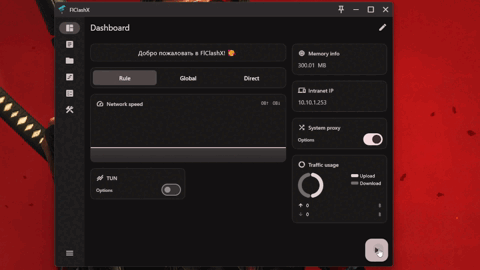
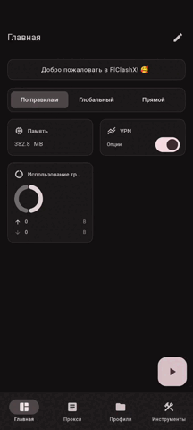

<div align="right">

[简体中文](README.md) · [English](README_EN.md) · **Русский**

</div>

# FlClashX

[](https://github.com/gscsdx/WFlClashX/releases/latest)
[](https://github.com/gscsdx/WFlClashX/releases)
[](https://github.com/gscsdx/WFlClashX/actions)
[](LICENSE)

Мультиплатформенный прокси-клиент на ядре [Clash.Meta (mihomo)](https://github.com/MetaCubeX/mihomo): **интерфейс на Flutter, ядро на Go** — открытый исходный код, без рекламы.

Проект является форком [FlClash](https://github.com/chen08209/FlClash) → [FlClashX](https://github.com/pluralplay/FlClashX). В этом репозитории добавлены три основные вещи:

1. **Нативная версия для HarmonyOS NEXT** — ArkTS `VpnExtensionAbility` управляет тем же ядром на Go через NAPI-мост, а стек TUN переписан как полностью пользовательская реализация gVisor;
2. **Облачная сборка для всех платформ** — один конвейер GitHub Actions выпускает установщики для Android / Windows / Linux / macOS, релизы автоматизированы;
3. **Наведение порядка в интерфейсе** — новый градиентный экран запуска и сокращённая страница «О программе» (осталась только ссылка на проект).

> Кодовое имя **Wormhole**: имя пакета в `pubspec.yaml` — `wormhole`, BundleName для HarmonyOS — `com.wormhole.app`; исполняемые файлы и установщики для десктопа и Android сохраняют имя `FlClashX`.

Десктопный вид:

<p align="center">
  
</p>

Мобильный вид:

<p align="center">
  
</p>

---

## Поддерживаемые платформы

| Платформа | Архитектуры | Артефакты | Статус |
| --- | --- | --- | --- |
| **Android** | arm64-v8a / armeabi-v7a / x86_64 | APK (в том числе universal) | ✅ облачная сборка |
| **Windows** | amd64 / arm64 | ZIP + установщик Inno Setup | ✅ облачная сборка |
| **Linux** | amd64 / arm64 | deb / rpm / AppImage | ✅ облачная сборка |
| **macOS** | amd64 / arm64 | DMG | ✅ облачная сборка |
| **HarmonyOS NEXT** | arm64 | HAP | ✅ локальная сборка (нужна подпись DevEco) |

Версии ядра: mihomo `v1.19.28`; стек TUN основан на `metacubex/sing-tun v0.4.21` (в версии для HarmonyOS используется вендорный форк из репозитория).

---

## Загрузка

Установщики для нужной платформы — в разделе [**Releases**](https://github.com/gscsdx/WFlClashX/releases/latest). В релизе `v0.4.2` — 14 файлов:

| Платформа | Файлы |
| --- | --- |
| Android | `FlClashX-android-arm64-v8a.apk`, `-armeabi-v7a.apk`, `-x86_64.apk`, `-universal.apk` |
| Windows | `FlClashX-windows-amd64.zip` / `-setup.exe`, `FlClashX-windows-arm64.zip` / `-setup.exe` |
| Linux | `FlClashX-linux-amd64.AppImage` / `.deb` / `.rpm`, `FlClashX-linux-arm64.deb` |
| macOS | `FlClashX-macos-amd64.dmg`, `FlClashX-macos-arm64.dmg` |

### О подписях (важно)

Облачная сборка **не содержит коммерческих сертификатов подписи**, поэтому:

- **Android** — APK подписаны debug-ключом: устанавливаются для тестирования, но **не подходят для публикации в магазинах**;
- **Windows** — без подписи кода; SmartScreen покажет «Неизвестный издатель», выберите «Выполнить в любом случае»;
- **macOS** — dmg без подписи и нотаризации; открывайте через **правый клик → «Открыть»** либо выполните `xattr -cr /Applications/FlClashX.app`;
- **Linux** — deb/rpm без подписи; AppImage требует `chmod +x`.

Для официального распространения настройте собственные сертификаты (Android keystore, Apple Developer ID, сертификат подписи кода Windows).

---

## Возможности

### Ядро прокси

- Правила mihomo: режимы «правила» / «глобальный» / «прямое подключение», подписки, группы прокси, тесты задержки, список соединений и статистика трафика в реальном времени;
- Режим TUN (Windows / Linux / macOS / Android / HarmonyOS) и режим системного прокси (десктоп);
- Проксирование по приложениям (Android / HarmonyOS), сопоставление процессов, маршрутизация по DNS и GeoIP.

### Интеграция с панелью подписок (для [Remnawave](https://github.com/remnawave/panel))

- **Передача HWID** — отправка отпечатка устройства на панель;
- **Виджет «Объявления»** — показывает объявления панели на главном экране;
- **Виджет Meta-Info** — остаток трафика, дата окончания и название подписки; за 3 дня до окончания выделяется;
- **Виджет serviceInfo** — название сервиса и собственный логотип, нажатие открывает ссылку поддержки;
- **changeServerButton** — быстрый переход на страницу прокси;
- **Порядок виджетов задаётся подпиской** — см. `flclashx-widgets` ниже.

### Интерфейс

- Градиентный экран запуска на весь экран, без белой вспышки;
- Страница «О программе» сокращена до одного пункта «Проект» со ссылкой на [этот репозиторий](https://github.com/gscsdx/WFlClashX);
- Поддержка 120 Гц на Android; оптимизация управления с пульта Android TV (кнопка «Вставить», выбор группы, передача профиля по QR с телефона);
- Нативный режим строки состояния в macOS;
- Настраиваемая прозрачность фона интерфейса;
- Локализация: 简体中文 / English / 日本語 / Русский.

### Версия для HarmonyOS NEXT

- `VpnExtensionAbility` содержит процесс VPN-расширения и общается с процессом интерфейса по RPC; при падении ядра действует бюджет перезапусков;
- Ядро на Go собирается как `c-shared` библиотека (`libclash_core.so`) и подключается через NAPI — без gomobile и JVM;
- **Ключевая адаптация TUN**: в OHOS вызов `fstat()` для файлового дескриптора `VpnService` возвращает `EACCES`, из-за чего fdbased-эндпоинт gVisor не инициализируется. Поэтому используется **полностью пользовательский channel-эндпоинт**, а пакеты пересылаются сырыми вызовами `unix.Read/Write + unix.Poll`, что обходит зависимость netpoller от `fstat` (см. `core/third_party/sing-tun/tun_linux_gvisor.go`);
- Архитектура, история отладки и данные проверки — в [**OHOS-DELIVERY.md**](OHOS-DELIVERY.md) (на китайском), окружение и шаги сборки — в [ohos/README.md](ohos/README.md).

---

## Настройка со стороны подписки

Клиент читает несколько расширенных ключей `flclashx-*` из HTTP-заголовков ответа подписки и из YAML-конфига, чтобы настраивать внешний вид главного экрана и страницы прокси.

### HTTP-заголовки ответа

| Заголовок | Назначение |
| --- | --- |
| `flclashx-servicename` | Название сервиса (в виджете serviceInfo) |
| `flclashx-servicelogo` | Логотип сервиса (ссылка svg / png) |
| `flclashx-supporturl` | Ссылка поддержки, открывается из serviceInfo |
| `flclashx-widgets` | Порядок и видимость виджетов главного экрана через запятую |
| `flclashx-view` | Внешний вид страницы прокси |

Допустимые значения `flclashx-widgets`:

| Значение | Виджет | Значение | Виджет |
| --- | --- | --- | --- |
| `announce` | Объявления | `intranetIp` | Локальный IP |
| `networkSpeed` | Скорость сети | `memoryInfo` | Использование памяти |
| `outboundModeV2` | Режим прокси (новый) | `metainfo` | Данные подписки |
| `outboundMode` | Режим прокси (старый) | `changeServerButton` | Смена сервера |
| `trafficUsage` | Расход трафика | `serviceInfo` | Информация о сервисе |
| `networkDetection` | Внешний IP и регион | `tunButton` | Переключатель TUN (десктоп) |
| `vpnButton` | Переключатель VPN (Android) | `systemProxyButton` | Системный прокси (десктоп) |

Пример:

```
flclashx-widgets: announce,metainfo,outboundModeV2,networkDetection
```

### Ключи YAML

- `flclashx-override` (внутри группы `GLOBAL`): при `true` в глобальном режиме страница прокси показывает только узлы этой группы в заданном порядке, а сервисные группы режима правил скрываются;
- `description` (любая группа прокси): заменяет подзаголовок по умолчанию под названием группы.

---

## Сборка из исходников

### Требования

| Назначение | Зависимости |
| --- | --- |
| Общее | Flutter (в CI зафиксирован **3.41.7**), Dart SDK ≥ 3.5, Go ≥ 1.20 (в CI **1.26**) |
| Android | Android SDK + NDK **28.0.13004108** |
| Windows | Visual Studio 2022 (рабочая нагрузка C++ для десктопа), Inno Setup 6 (установщик) |
| Linux | `clang`, `cmake`, `ninja-build`, `libgtk-3-dev` |
| macOS | Xcode |
| HarmonyOS | DevEco Studio 5.0+, Flutter-OH SDK, инструментарий Go для HarmonyOS |

```bash
flutter pub get
```

### Десктоп / Android

Единая точка входа — `setup.dart` в корне репозитория (сначала кросс-компилирует ядро на Go, затем вызывает `flutter build` и упаковывает):

```bash
# Синтаксис: dart setup.dart <android|windows|linux|macos> [--arch amd64|arm64] [--env stable]
dart setup.dart android                  # APK для Android (все ABI)
dart setup.dart windows --arch amd64
dart setup.dart linux   --arch arm64
dart setup.dart macos   --arch arm64 --env stable
```

Артефакты складываются в `dist/`. Для частых вариантов есть цели Makefile:

```bash
make android_app        # Android, все ABI
make android_arm64      # Android arm64
make macos_arm64        # macOS arm64
make macLocal           # очистить dist/build и пересобрать macOS arm64 (stable)
make cleanLocal         # удалить dist и build
```

### HarmonyOS NEXT

```bash
# 1) Кросс-компиляция ядра Go → ohos/entry/libs/arm64-v8a/libclash_core.so
cd core
OHOS_GO=/path/to/ohos-go/bin/go \
OHOS_NDK=/path/to/sdk/default/openharmony/native \
  ./build_ohos.sh

# 2) Упаковка HAP
cd ..
flutter build hap --target-platform ohos-arm64 --release
# или только hvigor: cd ohos && hvigorw assembleHap
```

Важные замечания:

- Нужен именно **Flutter-OH** (`gitee.com/openharmony-sig/flutter_flutter`), а не официальный Flutter; не выполняйте `flutter upgrade`;
- При первой сборке нужно перенести сгенерированные Flutter-OH каталог `har/`, `GeneratedPluginRegistrant.ets` и конфигурацию подписи в `ohos/`;
- **После изменения `.so` обязательно очистите нативный кеш перед упаковкой** (`ohos/entry/build/default/intermediates/{stripped_native_libs,libs}`), иначе в HAP попадёт старое ядро;
- Подпись настраивается в DevEco Studio (`File → Project Structure → Signing Configs`); ограниченное ACL-разрешение (`ACCESS_EXTENSIONAL_DEVICE_DRIVER`) нужно объявить в `allowed-acls` профиля подписи.

Полные руководства: [ohos/README.md](ohos/README.md) и [OHOS-DELIVERY.md](OHOS-DELIVERY.md) (оба на китайском).

---

## Облачные сборки (GitHub Actions)

В репозитории четыре рабочих процесса, и все они работают **без каких-либо секретов**:

| Рабочий процесс | Запуск | Что делает |
| --- | --- | --- |
| `ci.yml` | push в main при изменениях `lib/**`, `core/**`, `setup.dart`, `pubspec*` | Дымовая сборка Android (проверка компиляции) |
| `build.yml` | **вручную** (Actions → build → Run workflow) | Android + Windows (amd64/arm64) + Linux (amd64/arm64) — 5 задач |
| `macos.yml` | вручную, либо при изменении `setup.dart` / самого файла | macOS amd64 + arm64, два DMG |
| `release.yml` | push тега `v*` | Сборка всех 7 целей + автоматическое создание GitHub Release |

Почему macOS вынесена отдельно: раннеры macOS у GitHub очень востребованы, и задача, слишком долго стоящая в очереди, отменяется (`The job was not acquired by Runner of type hosted`). Отделив её от матрицы из 5 платформ, мы заметно повышаем шанс получить раннер.

### Процесс релиза

```bash
git tag -a v0.4.3 -m "описание"
git push origin v0.4.3
```

После отправки тега все платформы собираются автоматически и публикуется Release; если тег содержит `-` (например, `v0.4.3-beta.1`), релиз помечается как pre-release.

---

## Структура репозитория

```
lib/                    Интерфейс и логика на Flutter (страницы, состояние, слой управления Clash)
core/                   Обёртка ядра на Go (mihomo), build_ohos.sh и вендорный sing-tun
  third_party/sing-tun/ Форк TUN для HarmonyOS (channel-эндпоинт + сырой ввод-вывод fd)
ohos/                   Проект HarmonyOS NEXT (ArkTS VpnExtensionAbility + NAPI-мост)
android/ windows/ linux/ macos/    Проекты отдельных платформ
arb/                    Локализация (zh_CN / en / ja / ru)
setup.dart              Оркестратор сборки (кросс-компиляция ядра + flutter build + упаковка)
services/helper/        Привилегированный вспомогательный процесс для десктопа
.github/workflows/      CI: ci / build / macos / release
```

---

## Известные ограничения

- **HarmonyOS**: определение принадлежности процесса приложению (`ResolveProcess`) не реализовано; быстрые плитки, виджеты рабочего стола и поддержка ТВ вне текущего объёма; уведомление — базовое постоянное;
- **Десктоп**: режим TUN в Linux требует root или `CAP_NET_ADMIN`;
- **Подписи**: ни один облачный артефакт не подписан коммерчески — для магазинов настройте свои сертификаты;
- **macOS**: приложение не нотаризовано, при первом запуске нужно открывать через правый клик.

---

## Благодарности и лицензия

- Ядро: [MetaCubeX/mihomo](https://github.com/MetaCubeX/mihomo) (Clash.Meta)
- Стек TUN: [MetaCubeX/sing-tun](https://github.com/MetaCubeX/sing-tun)
- Клиенты-предшественники: [chen08209/FlClash](https://github.com/chen08209/FlClash), [pluralplay/FlClashX](https://github.com/pluralplay/FlClashX)
- Поддержка Flutter для HarmonyOS: [openharmony-sig/flutter_flutter](https://gitee.com/openharmony-sig/flutter_flutter)

Проект распространяется по лицензии [GPL-3.0](LICENSE). Используйте программное обеспечение в соответствии с местным законодательством.
